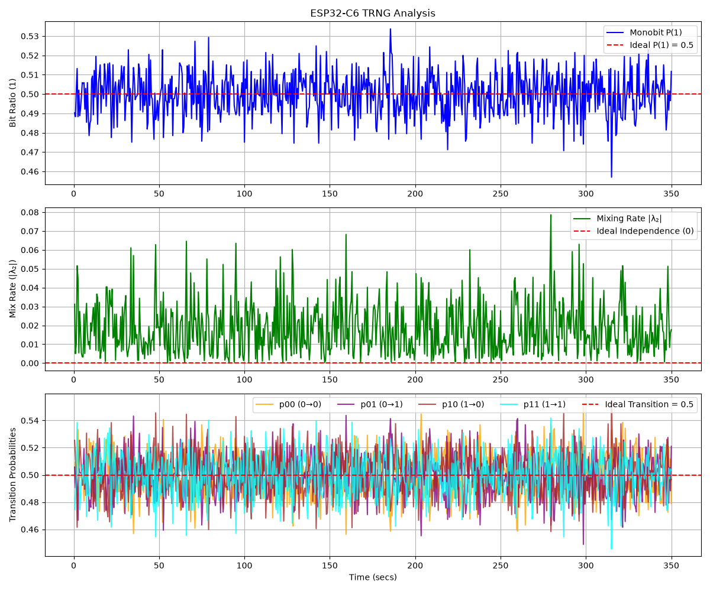

# ESP32-C6 First-Order Markov Test for Entropy Estimation

This project implements a real-time entropy evaluator running on an ESP32-C6 (RISC-V) microcontroller. Its purpose is to generate true random numbers using the chip’s TRNG (True Random Number Generator) hardware subsystem and to analytically verify their statistical quality and temporal independence.

### Metrics Analyzed

The processing script evaluates the frames transmitted by the ESP32-C6, extracting the following statistical metrics:


 * Monobit $P(1)$: Proportion of high bits ($1$) relative to the total samples analyzed within the time window. Validates the global bias of the source. A value far from $0.5$ indicates a physical imbalance toward zeros or ones.

* Mixing Rate $\vert{}\lambda_2\vert{}$: Magnitude of the second eigenvalue of the bit chain's Markov transition matrix. Measures how quickly the Markov chain converges to its stationary distribution. The closer to $0$, the greater the temporal asymptotic independence between samples.

* Conditional Transitions ($p_{00}, p_{01}, p_{10}, p_{11}$): 1st-order Markov transition probabilities between consecutive bit pairs ($P(\text{next} \mid \text{current})$).$0.5$ per branchEvaluates system memory. In a truly random source, a previous state must not condition the next bit; thus, staying or changing must be equiprobable ($50\%$).

Hardware Entropy Acquisition: Direct interaction with the TRNG core integrated into the ESP32-C6 via the ESP-IDF API (```esp_fill_random```). 


### Empirical Results (Real-Board Series Monitor)

Screenshot of the execution on a real ESP32-C6 mapped via WSL and usbipd:

```text
[*] Connecting serial port /dev/ttyACM0 at 115200 baud...
[*] Capturing entropy data from the ESP32-C6. Press Ctrl+C to finish, plot, and generate a report.
[Capture] Time: 32.52s | P(1): 0.5039 | p(0→0): 0.469 | p(0→1): 0.531 | p(1→1): 0.478 | p(1→0): 0.522 | λ₂: 0.0533
[Capture] Time: 33.02s | P(1): 0.5039 | p(0→0): 0.487 | p(0→1): 0.513 | p(1→1): 0.495 | p(1→0): 0.505 | λ₂: 0.0181
[Capture] Time: 33.52s | P(1): 0.5107 | p(0→0): 0.481 | p(0→1): 0.519 | p(1→1): 0.502 | p(1→0): 0.498 | λ₂: 0.0166
[Capture] Time: 34.02s | P(1): 0.5088 | p(0→0): 0.492 | p(0→1): 0.508 | p(1→1): 0.509 | p(1→0): 0.491 | λ₂: 0.0012
[Capture] Time: 34.52s | P(1): 0.5132 | p(0→0): 0.483 | p(0→1): 0.516 | p(1→1): 0.510 | p(1→0): 0.489 | λ₂: 0.0061
[Capture] Time: 35.02s | P(1): 0.5142 | p(0→0): 0.479 | p(0→1): 0.521 | p(1→1): 0.508 | p(1→0): 0.492 | λ₂: 0.0131
[Capture] Time: 35.52s | P(1): 0.4849 | p(0→0): 0.511 | p(0→1): 0.489 | p(1→1): 0.480 | p(1→0): 0.520 | λ₂: 0.0083
[Capture] Time: 36.02s | P(1): 0.4937 | p(0→0): 0.491 | p(0→1): 0.509 | p(1→1): 0.478 | p(1→0): 0.522 | λ₂: 0.0309
[Capture] Time: 36.52s | P(1): 0.5073 | p(0→0): 0.491 | p(0→1): 0.509 | p(1→1): 0.506 | p(1→0): 0.494 | λ₂: 0.0036
```
### Statistical Report



Upon completion of the run, the system calculates the mean ($\mu$) and standard deviation ($\sigma$) for each parameter. If the means of the Markov transitions converge stably around $0.5$, the proportion $P(1)$ fluctuates symmetrically around $0.5$, and the second eigenvalue $\vert{}\lambda_2\vert{}$ remains close to $0$.

```text
=================================================================
ENTROPY STATISTICAL EVALUATION REPORT
=================================================================
 Date and Time of the Report: 2026-10-25 20:23:36
 Device:              ESP32-C6 (TRNG Evaluator)
 Number of Sampless:        558
 Duration of the capture:   232.5 seconds
-----------------------------------------------------------------
 Monobit P(1)       -> μ: 0.5011  |  σ: 0.01107  --Ideal: ~N(0.5,0.0)
 Mix Rate           -> μ: 0.0170  |  σ: 0.01315  --Ideal: ~N(0.0,0.0)
 Transition 0→0     -> μ: 0.4985  |  σ: 0.01547  --Ideal: ~N(0.5,0.0)
 Transition 0→1     -> μ: 0.5015  |  σ: 0.01547  --Ideal: ~N(0.5,0.0)
 Transition 1→0     -> μ: 0.4993  |  σ: 0.01538  --Ideal: ~N(0.5,0.0)
 Transition 1→1     -> μ: 0.5007  |  σ: 0.01538  --Ideal: ~N(0.5,0.0)
=================================================================

[+] Report successfully saved as 'entropy_report.txt'.
[+] Generating Plots...
[+] Plot successfully saved as 'entropy_analysis_plot.png'.
```

### Future Work

To transition this project from a real-time monitoring tool to a fully compliant cryptographic entropy source, future developments will focus on integrating the standard's three mandatory health and evaluation tests directly into the pipeline:

* Repetition Count Test (RCT): Implement the real-time health test mandated by NIST to detect immediate hardware failures or sensor lock-ups. The firmware will continuously monitor the most frequent sample value. If any repeating bit pattern exceeds the strict statistical cutoff threshold ($C$) determined by the target min-entropy, the system will immediately flag a critical hardware fault and halt generation.

* Adaptive Proportion Test (APT): Detect non-stationarity, sudden environmental shifts, or dynamic biases over short observation windows. The system will evaluate sliding windows of $W = 512$ samples, counting the occurrences of specific bit patterns. If the proportion within a single window breaches the calculated confidence interval bounds, an adaptive failure alert will be triggered.

* Full Non-IID Min-Entropy Estimation: Move beyond live statistical approximations to compute the Min-Entropy ($H_{min}$) of the physical TRNG. Add a raw binary dump mode in the ESP32-C6 firmware to capture massive datasets ($>10^6$ samples) via Python, allowing automated execution of the official NIST C-based test suite to evaluate collision, Markov, suffix tree, and compression estimators.